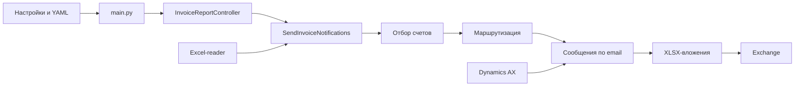

# Notiocer · 1.0.0

Рассылка счетов из Excel: отбор, маршрутизация по отделам и сотрудникам,
XLSX-вложение для каждого получателя и отправка через Microsoft Exchange.
Адреса сотрудников ищутся по `EMPLID` в Dynamics AX.

> **Кэш AX отключён:** каждый поиск email обращается к базе.
> JSON-кэш не читается и не обновляется; для поиска требуется открытое соединение с AX.

## Запуск

Python 3.12+, ODBC Driver для SQL Server, доступ к AX и Exchange.
Из корня проекта в PowerShell:

```powershell
python -m venv .venv
.\.venv\Scripts\Activate.ps1
python -m pip install -r requirements.txt
Copy-Item .env.example .env
# Заполните .env и положите отчёт в workdir/DZ_Report.xls.
python main.py
```

`main.py` выполняет реальную рассылку. Проверки ниже не подключаются
к внешним системам и не отправляют письма.

## Конфигурация

Настройки читаются из корневого `.env` и окружения. Окружение имеет приоритет;
имена чувствительны к регистру. Пути отчёта и кэша разрешаются от корня
проекта. Пользовательский `mailing_rules_file` используется как задан;
относительный путь отсчитывается от папки запуска.

| Параметр | Значение |
|---|---|
| `ax__server`, `ax__database`, `ax__username`, `ax__password` | Обязательные параметры AX |
| `ax__odbc_driver` | По умолчанию `ODBC Driver 17 for SQL Server` |
| `ax__cache_path` | `data/user_cache.json`; сейчас не используется, кэш отключён |
| `exchange__username`, `exchange__password` | Обязательные доступы Exchange; включён autodiscover |
| `qlikview__executable_path` | Обязательный абсолютный путь к `Qv.exe` |
| `qlikview__arguments` | JSON-список аргументов запуска, по умолчанию `[]` |
| `qlikview__timeout_seconds` | Время ожидания генерации в секундах, по умолчанию `300` |
| `invoice_report_file__path` | `workdir/DZ_Report.xls`; `.xls` читает xlrd, `.xlsx` — openpyxl |
| `mailing_rules_file` | `config/invoice_routing_rules.yml` |
| `invoice_selection__allowed_categories` | JSON-список; по умолчанию `Д0`–`Д5`, `Д60` |
| `invoice_selection__minimum_invoice_age` | ISO 8601-интервал, по умолчанию `P3D` — трое суток |
| `message__subject`, `message__body` | Тема и текст письма |

Пример всех параметров — в [.env.example](.env.example).
Доступы не имеют значений по умолчанию. `.env`, кэш, отчёты и локальные
результаты исключены из Git.

## Обработка счетов

1. Читается первый лист отчёта; первая строка содержит заголовки.
2. Отбираются разрешённые категории с датой **строго старше**
   `текущее время − minimum_invoice_age` и признаком предоплаты `да`
   либо условием оплаты `До загрузки`. Сравнение идёт по точному локальному
   времени, не по календарным дням.
3. Правила YAML распределяют счета по получателям. Идентификаторы сотрудников
   разрешаются в email через AX; одинаковые итоговые адреса объединяются,
   равные счета не дублируются.
4. Все вложения создаются в памяти до начала отправки. Затем письма
   отправляются последовательно; в журнал выводится число прочитанных
   и отобранных счетов, подготовленных писем и подтверждённых отправок.

Reader и соединение AX освобождаются через `finally`. При ошибке отправки
обработка останавливается и исключение передаётся вызывающему коду.

## Правила маршрутизации

```yaml
rules:
  - services: ["ОКГ"]
    recipients:
      РФ: "team@example.com"
      default: employee
```

- `services` сопоставляется с колонкой «Сервис для срока оплаты».
- Ключи `recipients` — значения колонки «Рынок». `default` обязателен
  и используется для отсутствующего или неизвестного рынка.
- `employee` означает ответственного из колонки «Сотрудник»;
  другой получатель должен быть email-адресом.
- Применяются все совпавшие правила. Один счёт не добавляется повторно
  одному получателю. Неизвестные сервисы, отсутствующие сотрудники
  и ненайденные адреса пропускаются.
- Повреждённый YAML, повторные ключи и ошибки структуры останавливают
  запуск до сетевых подключений.

## Структура и зависимости

```text
main.py                         Композиция зависимостей и запуск
config/invoice_routing_rules.yml Правила маршрутизации
notiocer/
├── domain/
│   ├── models/                 Счёт, уведомление и правила маршрутизации
│   ├── services/               Отбор, выбор получателей и сборка уведомлений
│   └── ports/                  Контракт поиска email сотрудника
├── application/
│   ├── use_cases/              SendInvoiceNotifications
│   ├── commands/               Входные данные сценария
│   ├── dto/                    EmailAttachment и InvoiceEmail
│   └── ports/                  Контракты сценария, генерации, чтения и рассылки
├── infrastructure/
│   ├── ax/                     Поиск email и queries/employee_email.sql
│   ├── excel/                  Адаптеры xlrd и openpyxl
│   ├── exchange/               Отправка писем
│   ├── qlikview/               Запуск процесса QlikView
│   ├── config/                 Настройки и YAML-загрузчик
│   └── retry.py                Повтор инфраструктурных вызовов
└── presentation/cli/           Чтение локального файла и вызов сценария
tests/                          Зеркальная структура и проверки композиции
```



Домен не импортирует внешние слои. Приложение зависит от домена и вызывает
внешние операции через порты. Presentation вызывает сценарий через его
контракт; инфраструктура реализует внешние порты. Конкретные зависимости
связывает только `main.py`. Эти границы проверяются архитектурными тестами.

Модули используют прямые абсолютные импорты `notiocer.…`; `__init__.py`
описывают пакеты без массовых переэкспортов. Генерация отчёта вызывается через
порт `ReportGenerator`; адаптер `QlikViewReportGenerator` запускает QlikView.
Путь к EXE и аргументы передаются отдельными элементами команды: пути с пробелами
не нужно дополнительно заключать в кавычки внутри значения.

## Ограничения 1.0

- Журнал доставок не хранится. Повторный запуск после частичной отправки
  может повторить уже отправленные письма; автоматического повтора нет.
- Кэш email отключён: повторные поиски адреса выполняют повторные запросы к AX.
- Отсутствующие колонки и значения читаются как `None`. Отдельного отчёта
  о пропущенных счетах пока нет.
- Даты сравниваются в локальном времени без часового пояса.

## Проверки и документация

```powershell
python -m pytest -q
python -m ruff check .
python -m ruff format --check .
python -m pdoc --docformat google notiocer
```

Последняя команда открывает сервер документации на `http://localhost:8080`.
Краткие русские docstring описывают классы и методы.
